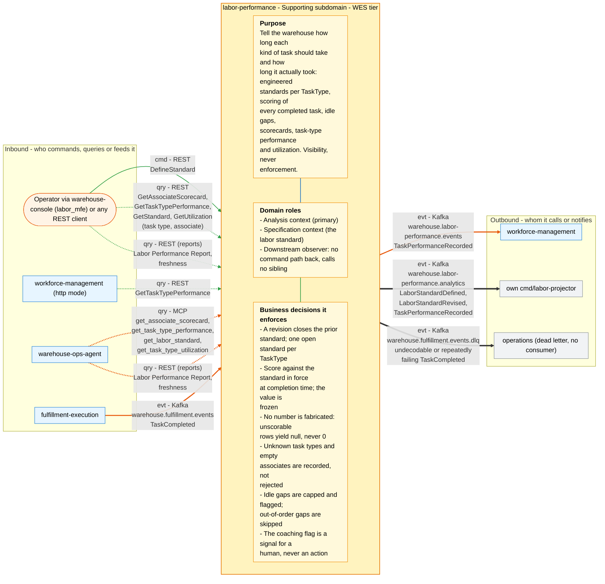

# Bounded Context Canvas

Following the [ddd-crew Bounded Context Canvas v5](https://github.com/ddd-crew/bounded-context-canvas).
Every message row below maps to a real REST route
(`internal/adapters/inbound/http/server.go`,
`internal/adapters/inbound/http/reports_handler.go`), MCP tool
(`internal/adapters/inbound/mcp/tools.go`) or Kafka topic + CloudEvents
type (`internal/adapters/kafka/cloudevents/cloudevents.go`).

## Canvas at a glance

One picture of the sections below, laid out like the ddd-crew canvas:
inbound collaborators on the left, this context in the middle (purpose,
domain roles and the business decisions it enforces), outbound
collaborators on the right. Arrows follow the message type: **solid blue**
commands (`cmd`), **dotted green** queries (`qry`), **thick orange** events
(`evt`); each arrow names its channel and the messages it carries. Box shapes
mark the collaborator kind: rounded = people, UI or any client; blue =
sibling bounded context; double border = external system or platform;
grey = this context's own projector, reports or dead-letter path; dashed =
published today with no consumer. Channel names on the arrows are
abbreviated (REST, MCP, Kafka, HTTP, port); the Inbound and Outbound
Communication tables carry the exact route, tool, topic and CloudEvents
type for every message.

Source: the Inbound Communication and Outbound Communication tables of this
page, which map to `internal/adapters/inbound/{http,kafka,mcp}` and `internal/adapters/outbound/`. The diagram omits assumptions, verification metrics, open
questions and the ubiquitous language (sections below), the relationship
pattern per message (OHS, ACL, Conformist, Customer/Supplier - see the
tables) and anything the tables mark as deprecated or platform-only
(health probes).

## Name

**Labor Performance** (`labor-performance`, CloudEvents subdomain `wes`,
`source` = `/warehouse/labor-performance`).

## Purpose

Tell a warehouse how long each kind of task *should* take and how long it
*actually* took. The context holds the engineered labor standard per
`TaskType` ("a PICK should take 45 s"), scores every completed task
against the standard that was in force when it finished, measures the idle
gap before each task, and turns those facts into per-associate
scorecards, fleet-wide task-type performance, utilization and an hourly
analytical report — without ever influencing how the work is executed.

## Strategic Classification

| Dimension | Value | Evidence |
|---|---|---|
| **Domain** | **Supporting** | [ADR 0002](../adr/0002-new-bounded-context-not-extension-of-workforce-or-fulfillment.md), [Subdomain classification](./subdomain-classification.md), [Core Domain Chart](./core-domain-chart.md) |
| **Business Model** | **Compliance / cost reduction** — makes labor productivity visible so staffing (in `workforce-management`) and coaching (by a human) can act on it; it earns no revenue and enforces nothing itself | ADR 0005 ("visibility, not enforcement"), ADR 0013 |
| **Evolution** | **Product** — engineered labor standards are an off-the-shelf WMS/LMS module | [Domain vision](../business-context/domain-vision.md) |

## Domain Roles

- **Analysis context** (primary) — it observes another context's facts
  and derives scores, trends and utilization from them.
- **Specification context** (secondary) — it owns one piece of reference
  data the rest of the fleet can rely on: the engineered labor standard
  per `TaskType`.
- **Downstream observer / gateway of none** — it has no command path back
  into execution and calls no sibling (ADR 0003).

## Inbound Communication

| Collaborator | Message | Type | Channel | Relationship |
|---|---|---|---|---|
| `fulfillment-execution` | `TaskCompleted` | Event | Kafka `warehouse.fulfillment.events`, CE type `com.warehouse.wes.fulfillment-execution.task.TaskCompleted` (group `labor-performance`) → `RecordTaskPerformance` | Conformist to upstream OHS/PL |
| Operator via `warehouse-console` (`labor_mfe`) | `DefineStandard` | Command | REST `POST /standards` (requires `Idempotency-Key` when Postgres is configured) | OHS |
| Operator via `warehouse-console` (`labor_mfe`) | `GetAssociateScorecard` | Query | REST `GET /associates/{associateId}/scorecard` | OHS |
| Operator via `warehouse-console` (`labor_mfe`); `workforce-management` (http mode) | `GetTaskTypePerformance` | Query | REST `GET /task-types/{taskType}/performance` | OHS |
| Any REST client | `GetStandard` | Query | REST `GET /standards/{taskType}` | OHS |
| Any REST client | `GetUtilization.ForTaskType` | Query | REST `GET /task-types/{taskType}/utilization?window=` | OHS |
| Any REST client | `GetUtilization.ForAssociate` | Query | REST `GET /associates/{associateId}/utilization?window=` | OHS |
| `warehouse-ops-agent` | `GetAssociateScorecard` | Query | MCP tool `get_associate_scorecard`; resource template `scorecard://labor/{associateId}` | OHS |
| `warehouse-ops-agent` | `GetTaskTypePerformance` | Query | MCP tool `get_task_type_performance` | OHS |
| `warehouse-ops-agent` | `GetStandard` | Query | MCP tool `get_labor_standard` | OHS |
| `warehouse-ops-agent` | `GetUtilization.ForTaskType` | Query | MCP tool `get_task_type_utilization` | OHS |
| `warehouse-console` (reports page), `warehouse-ops-agent` | Labor Performance Report | Query | REST (reports, `cmd/labor-reports` :8092) `GET /reports/performance?from=&to=&taskType=&granularity=` | OHS |
| `warehouse-console` (reports page), `warehouse-ops-agent` | Report freshness | Query | REST (reports) `GET /reports/performance/freshness` | OHS |
| this context (`cmd/labor`) → `cmd/labor-projector` | `LaborStandardDefined`, `LaborStandardRevised`, `TaskPerformanceRecorded` | Event | Kafka `warehouse.labor-performance.analytics` (group `labor-performance-analytics`, earliest offset) | internal — same context |

## Outbound Communication

| Collaborator | Message | Type | Channel | Relationship |
|---|---|---|---|---|
| `workforce-management` | `TaskPerformanceRecorded` | Event | Kafka `warehouse.labor-performance.events`, CE type `com.warehouse.wes.labor-performance.performance.TaskPerformanceRecorded`, key `associate_id` | OHS + Published Language; WFM is Conformist |
| own `cmd/labor-projector` | `LaborStandardDefined` | Event | Kafka `warehouse.labor-performance.analytics`, CE type `com.warehouse.wes.labor-performance.standard.LaborStandardDefined`, key `task_type` | internal |
| own `cmd/labor-projector` | `LaborStandardRevised` | Event | Kafka `warehouse.labor-performance.analytics`, CE type `com.warehouse.wes.labor-performance.standard.LaborStandardRevised`, key `task_type` | internal |
| own `cmd/labor-projector` | `TaskPerformanceRecorded` | Event | Kafka `warehouse.labor-performance.analytics`, CE type `com.warehouse.wes.labor-performance.performance.TaskPerformanceRecorded`, key `task_type` | internal |
| operations (no consumer) | undecodable or repeatedly failing `TaskCompleted` | Event (dead letter) | Kafka `warehouse.fulfillment.events.dlq` (original bytes + `x-dlq-*` headers) | — |

There is **no outbound command or query**: no REST or MCP client to any
sibling exists (ADR 0003).

## Ubiquitous Language

Full glossary with code identifiers: [Ubiquitous language](./ubiquitous-language.md).
Top terms:

- **LaborStandard** — the expected seconds for one `TaskType`, with an
  append-only effective range.
- **TaskPerformance** — one completed task, scored and frozen.
- **StandardSecondsAtCompletion** — the standard in force *as of* the
  completion instant, copied onto the row.
- **EfficiencyPct** — `100 × standard ÷ actual`; `null` when either is
  not positive.
- **Idle Gap** (`IdlePeriod`) — previous completion → next claim.
- **Utilization** — task time ÷ (task time + idle time), as a percent.
- **Scorecard**, **Trend**, **CoachingFlag** — per-associate read model
  and its two signals.

## Business Decisions

- A standard revision **closes** the prior standard and opens a new one;
  it never overwrites (ADR 0004). At most one open standard per
  `TaskType` (partial unique index, ADR 0022).
- A task is scored against the standard active **as of** its completion
  time, not the one active at ingestion; the value is frozen (ADR 0004).
- No number is ever fabricated: unscorable/unmeasurable rows yield `null`
  efficiency/means, never `0` (ADR 0006, CLAUDE.md non-negotiable 3).
- Unknown or absent `task_type` and empty `associate_id` are recorded,
  not rejected (`ParseTaskTypeLenient`).
- Idle gaps are capped at `IDLE_GAP_CAP_SECONDS` (default 3600) and
  flagged `capped`; out-of-order gaps are skipped, not failed (ADR 0014).
- Trend needs at least 3 scored recent tasks and a 5-point move; the
  coaching flag needs the last 3 scored tasks under 85 % (ADR 0005). The
  flag is a signal for a human, never an action.
- `TaskPerformance` is written only by the Kafka consumer; there is no
  REST write for it (CLAUDE.md non-negotiable 4).
- Decided 2026-10-06: the **open gap** stays per associate (ADR 0014).
  `GetUtilization.ForTaskType` reports `openGapSeconds: 0` by design and
  says so in the OpenAPI description. An idle gap belongs to an
  Associate; until that associate's next claim ends it, it has no task
  type, so attributing it to one would invent semantics. No code or
  contract change.

## Assumptions

- `fulfillment-execution` keeps publishing `TaskCompleted` with a
  meaningful `time` (completion instant) and `duration_seconds` (claim →
  completion); the idle-gap derivation depends on both.
- `TaskType` stays the closed set `PICK`, `PACK`, `SLAM` mirrored from
  `fulfillment-execution`'s `task.Type`; any other value is "unclassified".
- One associate does one task at a time, so previous completion → next
  claim is a meaningful idle gap.
- Shifts are not modelled here; the cap stands in for shift boundaries.

## Verification Metrics

- Business counter `labor_performance.standards.defined`, split by
  outcome accepted/rejected (`internal/adapters/outbound/telemetry/metrics.go`,
  ADR 0008).
- Outbox lag gauge `labor_performance.outbox.lag_seconds`, registered by
  `postgres.RegisterOutboxLagGauge`
  (`internal/adapters/outbound/postgres/outbox_metrics.go`).
- Report freshness lag from `GET /reports/performance/freshness`
  (`lagSeconds`).
- HTTP RED metrics (`http.server.request.duration`) and Kafka
  consume/publish spans exported over OTLP.

## Open Questions

- Who sets standards in practice? Today any unauthenticated REST client
  can `POST /standards` (ADR 0012 removed auth).
- The integration topic is keyed by `associate_id`; robot-station
  completions all share the empty key and therefore one partition.
- `warehouse.fulfillment.events.dlq` has no consumer or replay tooling.
- Utilization for robot stations is out of scope (no associate, no idle
  gap) — is that a gap someone needs filled?
- Resolved, decided 2026-10-06: the open gap stays per associate (ADR
  0014); at task-type scope `openGapSeconds` is always 0 by design, so
  this is no longer an open question.
